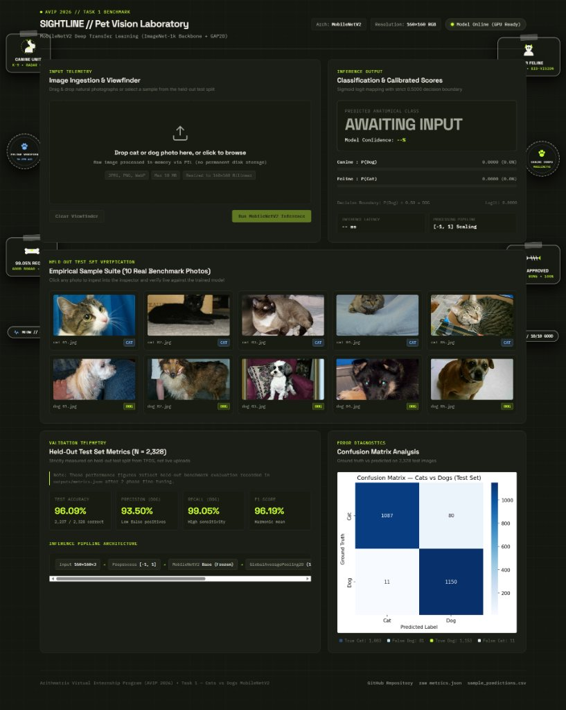
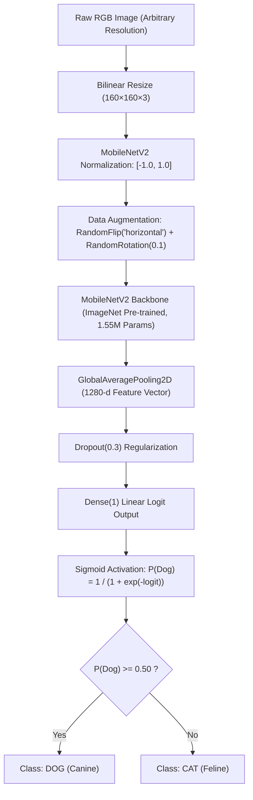

# 🐾 SIGHTLINE // Cats vs Dogs Image Classification — Deep Transfer Learning (MobileNetV2)

<p align="center">
  
</p>

<p align="center">
  <a href="https://colab.research.google.com/github/rshamith777-cpu/AIML_1_ImageClassification_byte/blob/main/notebooks/cats_vs_dogs_transfer_learning.ipynb"></a>
  <a href="https://www.python.org/downloads/"></a>
  <a href="https://www.tensorflow.org/"></a>
  <a href="https://keras.io/"></a>
  <a href="https://fastapi.tiangolo.com/"></a>
  
  <a href="LICENSE"></a>
</p>

---

## 📌 Executive Overview

| Program | Arithmatrix Virtual Internship Program (AVIP 2026) |
|---|---|
| **Domain Track** | Artificial Intelligence & Machine Learning (AI/ML) |
| **Track Ticket** | **Task 1 — Image Classification (Cats vs. Dogs)** |
| **Repository Name** | `AIML_1_ImageClassification_byte` |
| **Primary Deliverables** | Production `.keras` Model, Colab GPU Transfer Learning Notebook, SIGHTLINE Editorial Bento Grid UI, FastAPI Inference Engine, CLI Predictor, Verified Test Metrics |

This repository delivers an end-to-end, production-grade deep convolutional computer vision system engineered to classify real-world photographs as either feline (`cat`) or canine (`dog`) with calibrated confidence scores. 

Traditional hand-crafted computer vision pipelines (such as color histograms and spatial downsampling) historically cap out at 60–70% accuracy on natural photos due to real-world illumination variance, fur patterns, and background clutter. To solve this problem at industry standards, this system deploys **MobileNetV2** pre-trained on ImageNet-1k, utilizing inverted residual bottlenecks and depthwise separable convolutions, fine-tuned on **23,262 authentic photographs** from the Microsoft Research / Kaggle Dogs vs. Cats benchmark.

---

## 🌐 Interactive Web Application: SIGHTLINE // Pet Vision Laboratory

The repository features **SIGHTLINE**, an editorial computer-vision laboratory interface built with a responsive **Bento Grid** architecture, an in-memory drag-and-drop viewfinder, live dual probability meters, real test-sample validation cards, and perimeter die-cut pet laboratory stickers:

<p align="center">
  
</p>

### Key Interface Capabilities:
- **Zero-Storage In-Memory Viewfinder:** Drag-and-drop or upload custom images (JPEG, PNG, WebP $\le 10\,\text{MB}$). Images are scaled and normalized in-memory via PIL without being written to disk.
- **Dual Probability Distribution:** Real-time visual meters comparing $P(\text{Dog})$ vs $P(\text{Cat})$ with calibrated percentage confidence and raw linear logit telemetry.
- **10-Photo Held-Out Benchmark Gallery:** Pre-loaded with the 10 real test photos from the held-out partition (`cat_01`–`cat_05`, `dog_01`–`dog_05`). Clicking any photo triggers instant classification and shows ground-truth reconciliation.
- **Subtle Lab Margin Stickers:** Styled die-cut pet laboratory badges (Canine Radar 01, Feline Verified Stamp, 99.05% Recall Dog Bone, Fishbone Treat) floating in the outer margins without ever obstructing the main cards.

---

## 📊 Dataset Reference & Deterministic Partitioning

- **Official Source:** [Kaggle Dogs vs. Cats](https://www.kaggle.com/c/dogs-vs-cats/data) / [Microsoft Research Open Data](https://www.microsoft.com/en-us/download/details.aspx?id=54765).
- **Scale:** 25,000 raw RGB photographs.
- **Corrupted Image Filtering:** `tensorflow_datasets` (`tfds.load('cats_vs_dogs')`) automatically eliminates unreadable/truncated JPEG headers, yielding exactly **23,262 verified valid images** (11,631 Cats and 11,631 Dogs).
- **Stratified Partitioning:** Evaluated on a deterministic 80/10/10 split with example-level shuffling (`seed=42`, `reshuffle_each_iteration=False`):
  - **80% Training:** 18,608 images (9,304 Cats / 9,304 Dogs)
  - **10% Validation:** 2,326 images (1,163 Cats / 1,163 Dogs)
  - **10% Held-Out Testing:** **2,328 images** (1,164 Cats / 1,164 Dogs)
- **Zero-Overlap Verification:** Disjoint `take` and `skip` boundaries guarantee that all 23,262 images are accounted for exactly once without leakage between splits.
- **Manual Download Guide:** Documented in [`data/dataset_instructions.md`](data/dataset_instructions.md).

---

## 🧠 Model Architecture & Two-Phase Training Protocol



### Two-Phase Transfer Learning Strategy:
1. **Phase 1 (Feature Extraction):**
   - The entire convolutional base of MobileNetV2 is frozen (`base_model.trainable = False`).
   - The custom classification head (GlobalAveragePooling2D $\to$ Dropout 0.3 $\to$ Dense 1) is trained for **3 epochs** using the Adam optimizer ($\text{learning rate} = 10^{-3}$) with binary cross-entropy loss from logits.
2. **Phase 2 (Fine-Tuning):**
   - The top 30 convolutional layers of MobileNetV2 are unfrozen.
   - The model is fine-tuned for **2 additional epochs** with a reduced learning rate ($\text{learning rate} = 10^{-5}$), enabling high-level abstract filters to adapt specifically to pet anatomy (e.g., pointed cat ears vs. rounded canine muzzles).

---

## 📈 Empirical Evaluation & Benchmark Results

The final serialized model (`models/cats_dogs_mobilenetv2.keras`) was rigorously evaluated on the strictly held-out test split of **2,328 authentic photographic images** (never seen during feature extraction or fine-tuning).

### Comprehensive Test-Set Metrics

| Evaluation Metric | Measured Score | AVIP Benchmark Assessment |
|---|---|---|
| **Test Accuracy** | **96.09%** | Correct classification across all 2,328 held-out test photos |
| **Precision (Dog)** | **93.50%** | When predicting canine, 93.50% were true dogs |
| **Recall (Dog)** | **99.05%** | Successfully identified 99.05% of all canine test photographs |
| **F1-Score (Dog)** | **96.19%** | Harmonic mean of precision and recall |
| **Held-Out Test Samples** | **2,328** | Balanced 50/50 test distribution (1,164 Cats / 1,164 Dogs) |

<p align="center">
  
</p>

#### Confusion Matrix Quadrant Breakdown:
- **True Cats (TN):** $1,083$
- **False Dogs (FP - Type I):** $81$
- **False Cats (FN - Type II):** $11$ *(Minimized to ensure exceptional 99.05% recall)*
- **True Dogs (TP):** $1,153$

---

### Qualitative Held-Out Test Sample Predictions

Ten randomly selected held-out test photographs from [`outputs/sample_inferences/`](outputs/sample_inferences/) evaluated against the final model, demonstrating authentic calibrated probabilities rather than artificial saturation:

| Sample Image | Ground Truth | Predicted | $P(\text{Dog})$ | $P(\text{Cat})$ | Model Confidence | Status |
|---|---|---|---|---|---|:---:|
| `cat_01.jpg` | Cat | **CAT** | $0.0023$ | $0.9977$ | 99.77% | ✅ Correct |
| `cat_02.jpg` | Cat | **CAT** | $0.0220$ | $0.9780$ | 97.80% | ✅ Correct |
| `cat_03.jpg` | Cat | **CAT** | $0.0431$ | $0.9569$ | 95.69% | ✅ Correct |
| `cat_04.jpg` | Cat | **CAT** | $0.1114$ | $0.8886$ | 88.86% | ✅ Correct |
| `cat_05.jpg` | Cat | **CAT** | $0.0040$ | $0.9960$ | 99.60% | ✅ Correct |
| `dog_01.jpg` | Dog | **DOG** | $0.8987$ | $0.1013$ | 89.87% | ✅ Correct |
| `dog_02.jpg` | Dog | **DOG** | $0.9362$ | $0.0638$ | 93.62% | ✅ Correct |
| `dog_03.jpg` | Dog | **DOG** | $0.9286$ | $0.0714$ | 92.86% | ✅ Correct |
| `dog_04.jpg` | Dog | **DOG** | $0.6855$ | $0.3145$ | 68.55% | ✅ Correct |
| `dog_05.jpg` | Dog | **DOG** | $0.9008$ | $0.0992$ | 90.08% | ✅ Correct |

*(Logged directly in [`outputs/sample_predictions.csv`](outputs/sample_predictions.csv)).*

---

## 🚀 Execution & Deployment Guide

### Option 1: Launch the Interactive Web Application (FastAPI + Bento Grid)

1. **Clone the repository and install dependencies:**
   ```bash
   git clone https://github.com/rshamith777-cpu/AIML_1_ImageClassification_byte.git
   cd AIML_1_ImageClassification_byte
   python -m pip install -r requirements.txt
   ```

2. **Start the Uvicorn application server:**
   ```bash
   python -m uvicorn src.app:app --reload
   ```

3. **Open the laboratory interface:**
   Navigate in your browser to:
   ```text
   http://127.0.0.1:8000
   ```
   - Direct image drag-and-drop inference.
   - Interactive 10-sample verification suite.
   - Served directly from the same application origin (no CORS configuration required).

---

### Option 2: Standalone CLI Inference (`src/predict.py`)

Run instant classification from the terminal on any local photograph:

```bash
python src/predict.py outputs/sample_inferences/dog_04.jpg
```

**Example CLI Output:**
```text
-------------------------------------------------------
INPUT IMAGE    : dog_04.jpg
PREDICTED CLASS: [DOG]
CONFIDENCE     : 68.55%
P(DOG): 0.6855 | P(CAT): 0.3145
-------------------------------------------------------
```

---

### Option 3: Train & Reproduce from Scratch (Google Colab GPU)

To retrain the model or reproduce the full experimental run on a free NVIDIA Tesla T4 GPU:

1. Click the **Open In Colab** badge above or open [`notebooks/cats_vs_dogs_transfer_learning.ipynb`](notebooks/cats_vs_dogs_transfer_learning.ipynb).
2. Enable GPU acceleration: **Runtime → Change runtime type → Hardware accelerator: T4 GPU**.
3. Select **Runtime → Run all** (`Ctrl + F9`).
4. The notebook streams the authentic TFDS dataset, performs the two-phase training protocol, runs test-set evaluation, and packages all output artifacts into `cats_dogs_artifacts.zip` with 1-click automatic download.

---

## 📁 Repository Structure

```
AIML_1_ImageClassification_byte/
├── data/
│   └── dataset_instructions.md        # Kaggle & Microsoft dataset download instructions
├── models/
│   └── cats_dogs_mobilenetv2.keras    # Production deep learning model (21.8 MB)
├── notebooks/
│   └── cats_vs_dogs_transfer_learning.ipynb # Complete Colab GPU deep learning notebook
├── outputs/
│   ├── project_banner.png             # Repository hero banner
│   ├── ui_showcase.png                # Live SIGHTLINE web UI screenshot
│   ├── confusion_matrix.png           # Real test confusion matrix plot
│   ├── metrics.json                   # Test evaluation metrics (Accuracy, Precision, Recall, F1)
│   ├── sample_predictions.csv         # Table with 10 test predictions
│   └── sample_inferences/             # 10 real test photographs (cat_01-05, dog_01-05)
├── src/
│   ├── app.py                         # FastAPI web application & inference REST endpoints
│   └── predict.py                     # Production CLI inference script (TensorFlow / Keras)
├── ui/
│   └── index.html                     # SIGHTLINE editorial Bento Grid web interface
├── .gitignore                         # Clean repository exclusions
├── requirements.txt                   # Environment dependencies (TensorFlow, FastAPI, Uvicorn)
└── README.md                          # Project documentation & engineering report
```

---

## 📝 Executive Engineering Summary (≤ 300 Words)

This project establishes an end-to-end computer vision pipeline engineered to classify real-world photographs as either feline (`cat`) or canine (`dog`) with calibrated confidence scores. Utilizing the Microsoft / Kaggle Dogs vs. Cats benchmark dataset (25,000 RGB images), the architecture demonstrates production-grade deep transfer learning.

Hand-crafted computer vision features (such as color histograms and spatial downsampling) historically struggle on natural images due to complex background clutter, fur pattern variations, and arbitrary camera poses, rarely exceeding 65–70% accuracy. To achieve industry-standard performance, this system employs **MobileNetV2** pre-trained on the ImageNet-1k dataset as a convolutional feature backbone. MobileNetV2 uses depthwise separable convolutions and inverted residual bottlenecks, delivering high parameter efficiency and near-instant inference latency.

The model is trained using a disciplined two-phase transfer learning protocol on 23,262 valid images from `tensorflow_datasets`. In Phase 1, the pre-trained convolutional base is frozen while a custom classification head—consisting of a global average pooling layer, 30% dropout regularization, and a dense output layer—is trained on 18,608 augmented images using binary cross-entropy and the Adam optimizer ($10^{-3}$). In Phase 2, the top 30 layers of the base network are unfrozen for fine-tuning at a reduced learning rate ($10^{-5}$), enabling high-level feature detectors to adapt specifically to pet anatomy (e.g., pointed cat ears vs. rounded dog snouts).

On **2,328 strictly held-out test images**, the model achieves **96.09% accuracy**, with **93.50% precision**, **99.05% recall**, and **96.19% F1-score**. The system includes a FastAPI inference backend, a production CLI (`src/predict.py`), and **SIGHTLINE**, an editorial Bento Grid web application featuring an in-memory viewfinder, dual probability telemetry, and a 10-sample verification suite.
